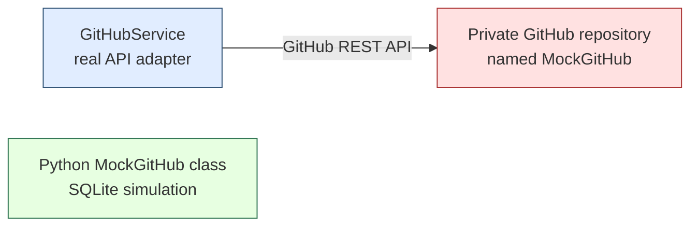
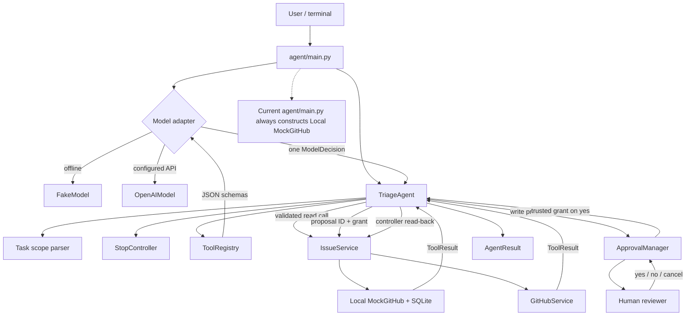
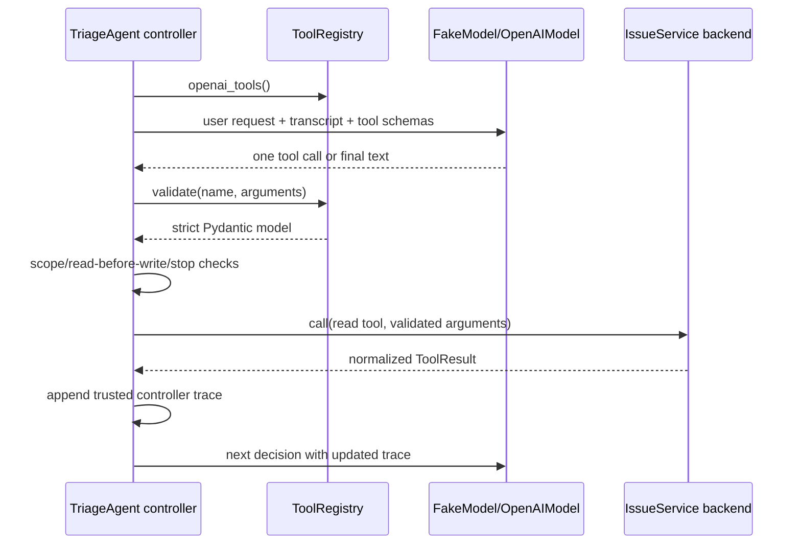
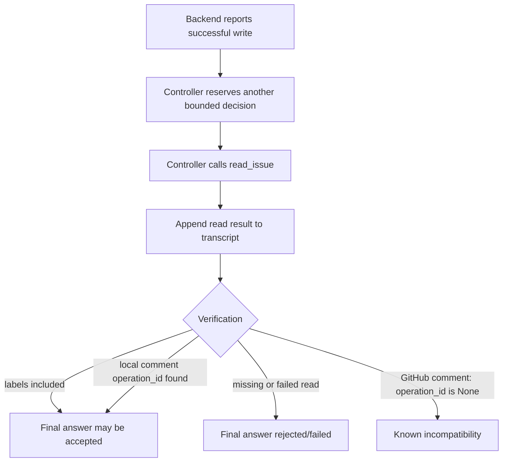
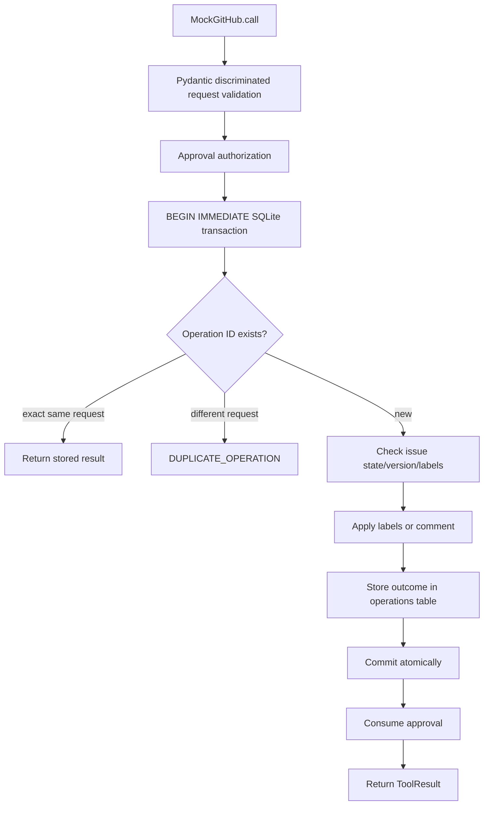
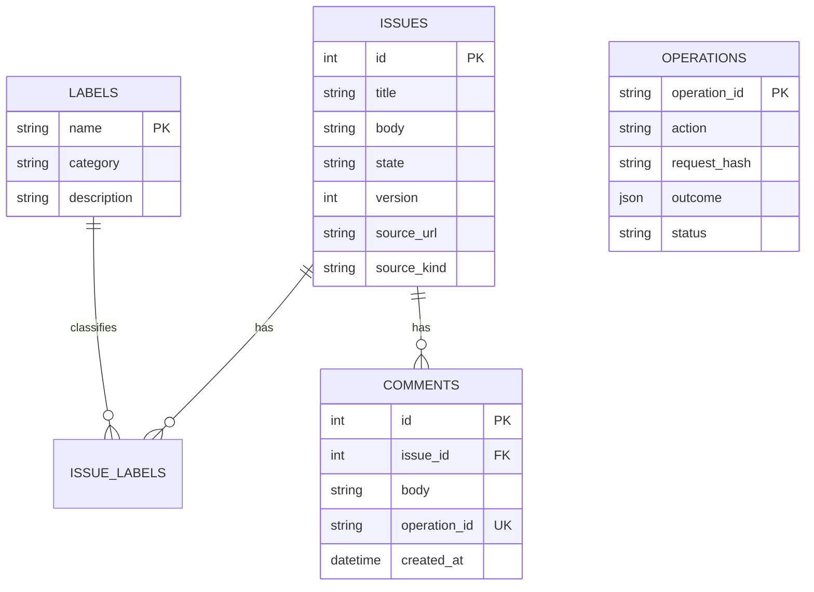
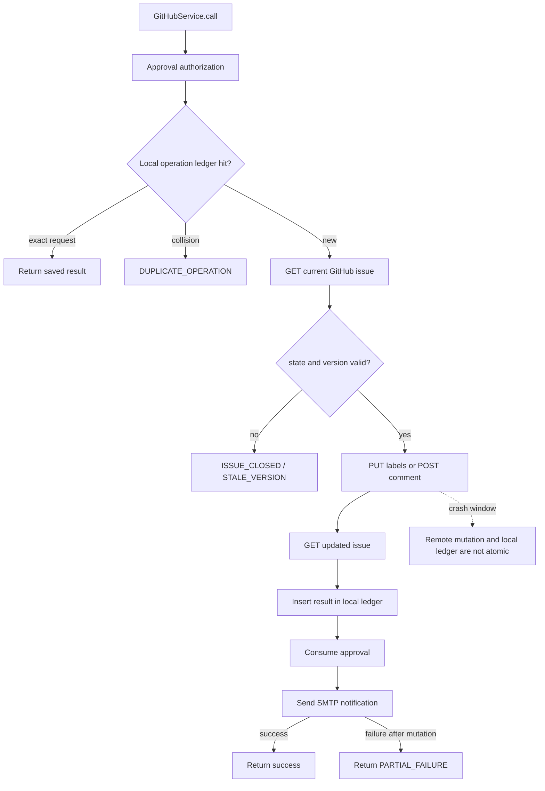
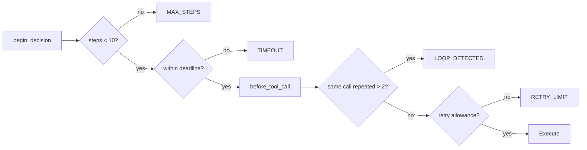
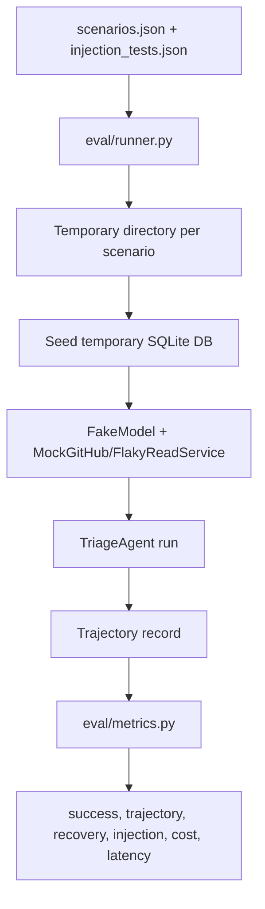
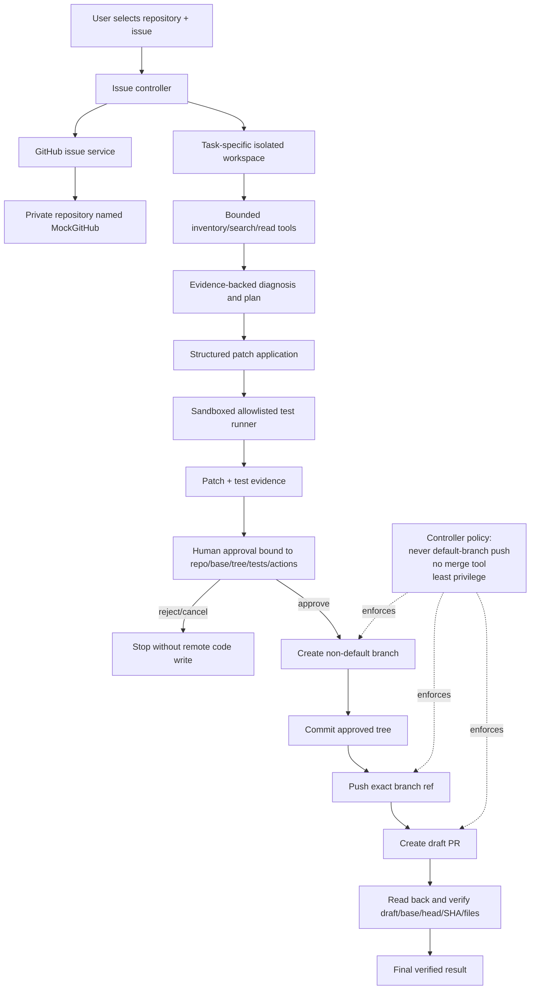

# Architecture

## 1. Names and trust boundaries

Do not confuse these components:

- **Private repository named `MockGitHub`:** a real, private team repository and future Level 2 target.
- **Python `MockGitHub` class:** a local SQLite simulation in `sandbox/mock_github.py`.
- **`GitHubService`:** the API adapter capable of talking to real repositories, including eventually the private repository.



The private repository was not accessed during this audit.

## 2. Implemented triage architecture



`IssueService` is an uncommitted runtime-checkable protocol in the current working tree. The diagram shows the intended dependency injection seam; it does not mean the AI CLI can select GitHubService today.

## 3. Model message and decision flow



OpenAIModel sends:

1. a system message containing the trusted triage policy;
2. a user message containing the original request;
3. a user message containing the controller trace, explicitly described as containing untrusted tool output;
4. generated function schemas with parallel calls disabled.

The model proposes actions. It does not dispatch tools, create approval grants, or decide whether evidence is sufficient for completion.

## 4. Human approval flow

```mermaid
sequenceDiagram
    participant M as LLM
    participant C as Controller
    participant S as Backend service
    participant A as ApprovalManager
    participant H as Human

    M-->>C: update_labels/post_comment arguments
    C->>C: validate schema, issue scope, prior reads
    C->>S: propose(tool, exact arguments, task_id)
    S->>A: register proposal + backend scope
    A-->>S: WriteProposal
    S-->>C: WriteProposal
    C->>H: show issue, rationale, exact action
    H-->>C: yes / no / cancel
    alt literal yes
        C->>A: decide(proposal_id, yes)
        A-->>C: ApprovalOutcome + private ApprovalGrant
        C->>S: call(tool, args, proposal_id, grant)
        S->>A: authorize(exact proposal, scope, grant)
        A-->>S: authorized
        S->>S: execute mutation and record outcome
        S->>A: consume(proposal_id)
        S-->>C: ToolResult
    else reject
        A-->>C: no grant / reject
        C-->>H: REJECTED; no write
    else cancel or terminal EOF
        A-->>C: no grant / cancel
        C-->>H: CANCELLED; no write
    end
```

The proposal fingerprint covers proposal ID, task ID, tool, and every argument. Scope separately binds it to a database path or repository URL. A forged boolean such as `approved=true` cannot create the private grant object.

## 5. Controller-owned verification



Label verification currently checks that labels returned by the write are included in the latest issue. Comment verification searches for the operation ID. That works locally but not for GitHub read-back comments. The future verifier should match the stable GitHub comment ID and approved body, with bounded read retries that never repost.

## 6. Local backend internals



SQLite schema relationships:



## 7. GitHubService internals



The ledger protects known exact retries only after it has recorded the remote result. A network/process failure between GitHub accepting a mutation and the ledger insert creates an uncertain outcome that must be reconciled remotely.

## 8. Stop and error architecture



Tool errors use `{ok, data, error}`. The logger normalizes Pydantic, approval, timeout, SQLite, and unexpected exceptions into safe responses and emits start/result events with task, step, correlation ID, arguments, duration, and redacted result.

## 9. Offline evaluation architecture



Current caveat: scenario expected statuses were not updated after reject/cancel became explicit terminal statuses. A fresh run scores seven safe rejections as failures. Fix the evaluator before using its headline success or injection metrics.

## 10. Target Level 2 architecture



The issue API service and workspace/git services should remain separate interfaces. The LLM should receive only narrow tools; it should never receive a general shell, raw host path, token, or arbitrary git refspec.
